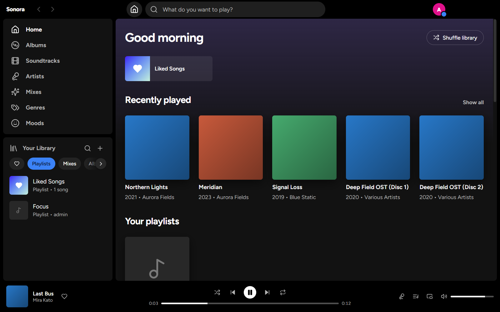
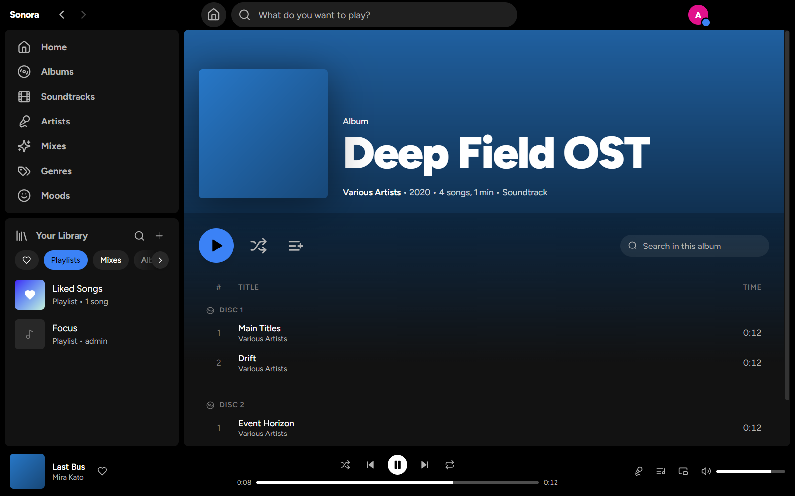
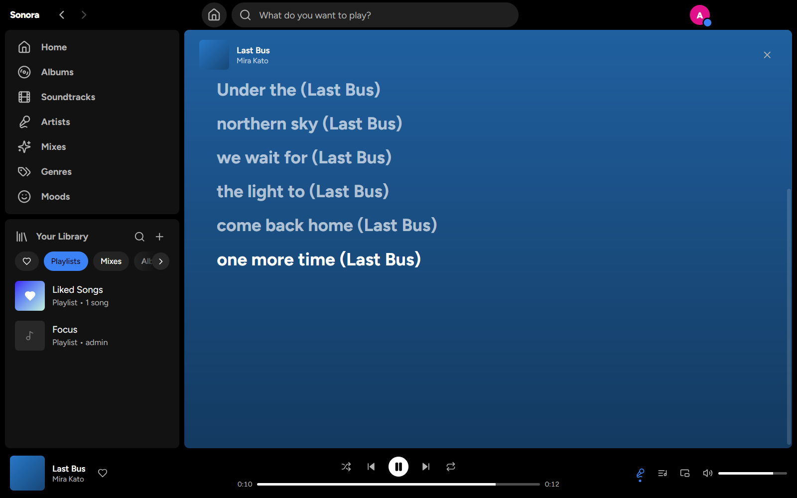
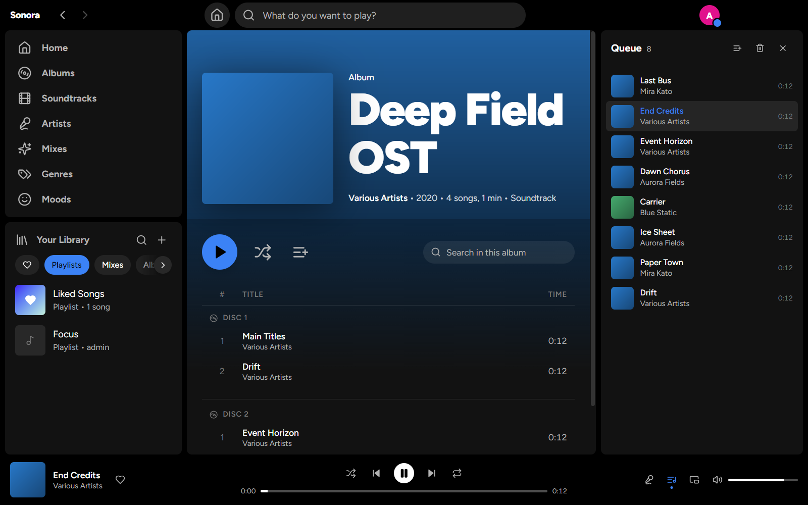
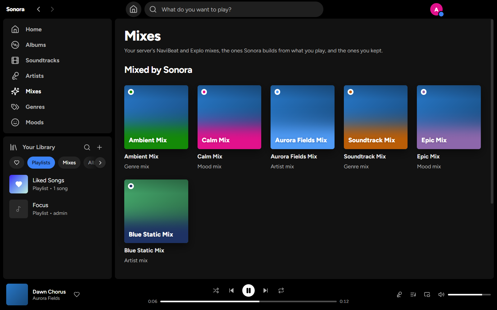
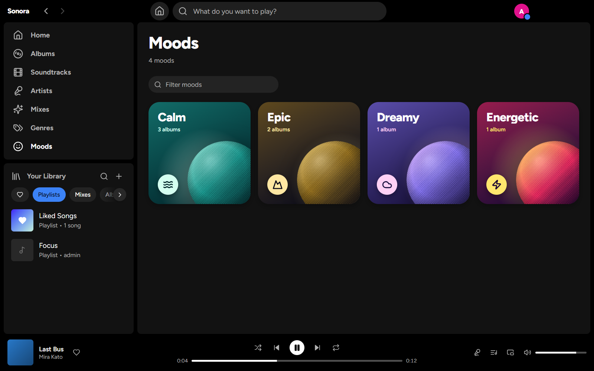
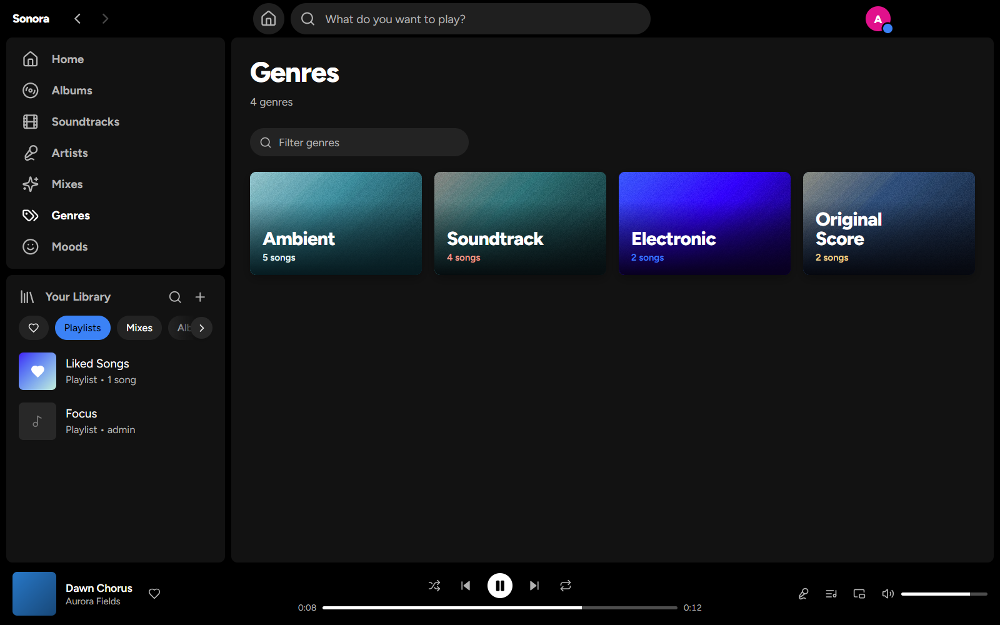
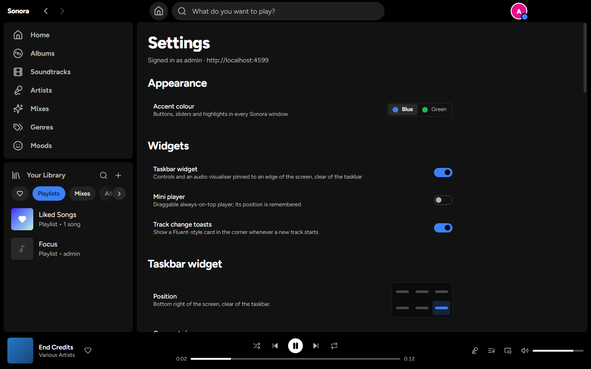

<div align="center">


# Lyria

**A Spotify-like desktop client for your own music server.**

Point it at a [Navidrome](https://www.navidrome.org/) (or any Subsonic/OpenSubsonic) server — it
gives you a Spotify-style library with mixes, genres and moods, synced lyrics, Fluent 2
track-change toasts, a floating mini-player and a taskbar-area widget with a live audio visualiser.

[](https://www.electronjs.org/)
[](https://react.dev)
[](https://www.typescriptlang.org/)
[](https://bun.sh)
[](#license)

</div>

---

## Screenshots

<table>
<tr>
<td width="50%">

**Home** — Liked Songs, recently played and your playlists, with a library panel beside it


</td>
<td width="50%">

**Album** — cover-tinted header, multi-disc track list, play/shuffle/queue actions


</td>
</tr>
<tr>
<td width="50%">

**Lyrics** — synced lyrics that stay on the beat between position updates


</td>
<td width="50%">

**Queue** — jump, drop or clear without leaving the current view


</td>
</tr>
<tr>
<td width="50%">

**Mixes** — your server's mixes plus ones Lyria builds from what you play


</td>
<td width="50%">

**Moods** — every mood gets artwork and a colour of its own


</td>
</tr>
<tr>
<td width="50%">

**Genres** — the same treatment for genres, drawn from your cover art


</td>
<td width="50%">

**Settings** — accent colour, widgets, normalisation and caches


</td>
</tr>
<tr>
<td width="50%">

**Mini-player** — always on top, remembers where you dragged it


</td>
<td width="50%">

**Toast** — animates in on every track change, click-through


</td>
</tr>
<tr>
<td colspan="2">

**Taskbar widget** — live visualiser bars at ~30fps


</td>
</tr>
</table>

## Features

- 🎵 **Spotify-style Library** — a sidebar with Home, Albums, Soundtracks, Artists, Mixes, Genres and Moods, a *Your Library* panel (playlists, mixes, albums, artists, with a heart filter for saved items) and a top bar with search, all backed by the Subsonic API
- ✨ **Mixes** — your server's NaviBeat and Explo mixes alongside genre, mood and artist mixes Lyria builds from what you play; keep the ones you like
- 🎨 **Genres & Moods** — cards with artwork and a look of their own, and page headers tinted from the cover art
- 🖌 **Accent Colour** — pick Blue or Green in Settings; it applies to every Lyria window
- 🎤 **Synced Lyrics** — OpenSubsonic structured lyrics with an LRC/SRT/plain fallback, extrapolated between position updates so the highlighted line tracks the audio
- 🔔 **Fluent Toasts** — a frameless, click-through, always-on-top card that animates in on every track change
- 🪟 **Mini-player** — draggable always-on-top player that remembers where you put it
- 📊 **Taskbar Widget** — acrylic flyout pinned above the taskbar with a canvas visualiser fed by a Web Audio `AnalyserNode` at ~30fps
- 📝 **Playlists** — create one from the library panel, from a track's context menu or from the whole queue, and add or remove songs from any row
- ❤️ **Liked Songs** — heart anything from a track row or the now-playing bar; liked tracks collect into their own playlist
- ⬇️ **Offline Downloads** — download a playlist or mix to play it with no connection; playlists follow the server, and plays made offline still reach your server's play counts once it is back. With the server out of reach, Home shows everything on this device and songs you can't play right now are greyed out
- 💾 **Compact Caches** — songs you play, cover art and library pages are kept on disk for instant loads; lossless songs are re-encoded to Opus at a bitrate you choose and covers to WebP, in the background
- ⏯ **Resume on Launch** — playback state is persisted on quit and restored where you left off
- 🔐 **Encrypted Credentials** — only the derived Subsonic token is stored, encrypted with Electron's `safeStorage`; the plain password is never persisted
- ⌨️ **Media Keys & Shortcuts** — global media keys (toggleable in Settings), plus `Space` play/pause, `Ctrl+←/→` previous/next, `Ctrl+↑/↓` volume, `Ctrl+K` or `/` to search and `Alt+←/→` to go back and forward
- 🧪 **Mock Server** — a bundled OpenSubsonic mock with synthetic audio, art and synced lyrics, so you can develop with no server at all

## Tech Stack

| Layer | Choice |
|---|---|
| Shell | Electron 33 + electron-vite, packaged with electron-builder |
| Frontend | React 19, Zustand, Tailwind CSS 4, Lucide icons |
| Styling tokens | `@fluentui/tokens` (Fluent 2) |
| Storage | `electron-store` + `safeStorage` for credentials |
| Server API | Subsonic / OpenSubsonic (Navidrome) |
| Tooling | [Bun](https://bun.sh) (package manager, scripts, tests), TypeScript 5.7 |

## Quick Start

Needs **Bun 1.1 or newer** and Windows 10/11 or Linux (X11 or Wayland). No music server required to
start — the mock covers it.

```bash
bun install   # Electron is downloaded by its postinstall; it is in trustedDependencies
bun run go    # mock server on :4599 + Electron with Vite HMR
```

Sign in with `http://localhost:4599` and any username/password. Pass `--no-mock` to point at a real
server instead.

> If you launch Electron from inside another Electron app's terminal (VS Code, T3 Code, ...), make
> sure `ELECTRON_RUN_AS_NODE` is not set, otherwise Electron starts as plain Node. `bun run go`
> strips it for you; `bun run dev` does not.

The floating widgets are tuned for the Windows 11 taskbar; on Linux they sit at the edge of the
work area, and the tray needs an AppIndicator/StatusNotifier host (GNOME needs an extension such as
AppIndicator Support). The Linux tray has no left-click handler, so use its **Show Lyria** entry.

## Development

```bash
bun run dev         # Electron with Vite HMR, no mock server
bun run mock        # mock OpenSubsonic server on :4599
bun test            # unit tests (lyrics parser, resume state)
bun run typecheck
bun run build       # production build into out/, run it with `bun run start`
bun run dist        # installer in release/ (NSIS on Windows, AppImage + deb on Linux)
bun run dist:dir    # unpacked app folder in release/
bun run icons       # regenerate resources/icon.png and tray icons from icon.svg (needs rsvg-convert)
bun run api:test -- --server URL --user U --pass P   # exercise the API client with no UI
```

End-to-end smoke test over the DevTools protocol:

```bash
bun run mock
bun run build && ./node_modules/.bin/electron . --remote-debugging-port=9222
bun run smoke       # signs in to the mock, plays, checks state from another window, then signs out
```

## Architecture

Only one place ever touches the `<audio>` element: a hidden audio host window owns playback, the
queue, volume and the `AnalyserNode`, and every visible window is a pure display layer talking to it
over an IPC relay. Windows, credentials, CORS and lyrics details:
**[docs/ARCHITECTURE.md](docs/ARCHITECTURE.md)**.

Releases are cut by a GitHub Actions workflow: **[docs/RELEASING.md](docs/RELEASING.md)**.

## Project Structure

```
lyria/
├── src/
│   ├── main/            # Electron main: windows, tray, IPC relay, store, credentials
│   ├── preload/         # window.lyria bridge
│   ├── shared/          # Types, Subsonic client, lyrics parser, formatters
│   └── renderer/
│       ├── main/        # Library UI (views/, components/)
│       ├── host/        # Hidden audio host: <audio> + AnalyserNode
│       ├── mini/        # Mini-player
│       ├── toast/       # Track-change toast
│       ├── widget/      # Taskbar widget + visualiser
│       └── shared/      # playerStore, theme, styles shared by every window
├── scripts/             # go, mock server, api-test, smoke, icon generation
├── tests/               # Bun unit tests
├── docs/                # Architecture, releasing, screenshots
└── resources/           # App and tray icons
```

## License

MIT.
